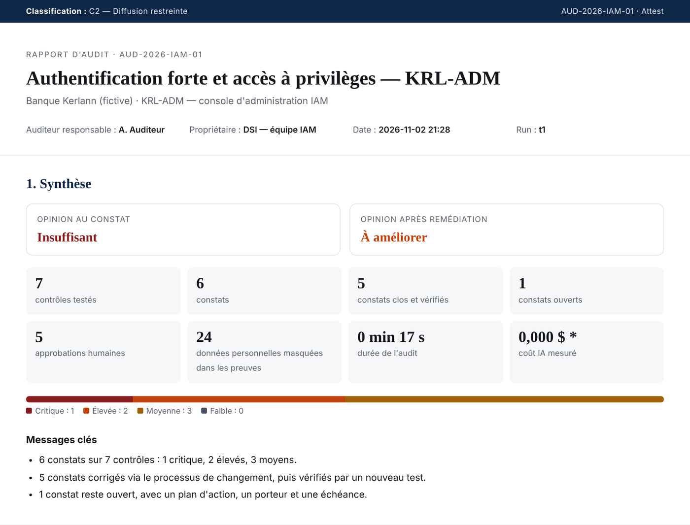
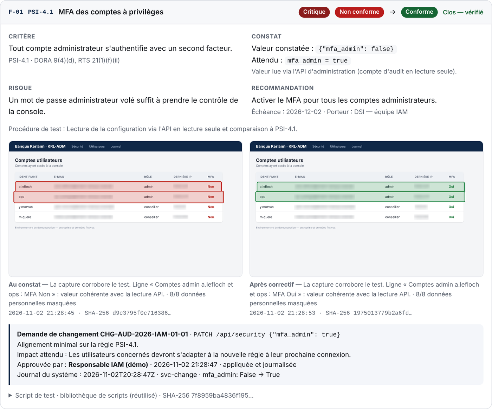

# Attest — the compliance auditor that tests instead of reading

**Meta Global AI Developer Hackathon · track "Build for Your World"**

Banks must prove to supervisors that their security controls work. Under **DORA** (EU Regulation 2022/2554,
applicable since 17 January 2025) that proof is still mostly built by hand: someone reads the policy, logs into
each system, takes screenshots, pastes them into a spreadsheet, and an auditor re-checks it all months later.

Attest is an AI agent that runs that audit the way a bank's second line of defence must run it:
it **tests** the system read-only, **seals** the evidence, **masks** personal data, drafts **change requests**
that a human owner approves, **re-tests** after the fix, and issues an audit report a CISO can sign.




## What happens in one run

| Step | What Attest does | Meta model |
|---|---|---|
| 1. Work programme | Reads the framework (DORA art. 9(4), RTS 2024/1774 art. 12 and 21, internal policy) and writes a catalogue of testable controls with severity, risk and recommendation. Cached for auditor review. | **Muse Spark 1.3** |
| 2. Test | Writes one read-only Python test per control, statically checked, executed with a read-only service account. The **verdict comes from the script, never from the model**. Scripts are kept in a reviewable library and replayed on later runs. | **Muse Spark 1.3** |
| 3. Evidence | Captures the admin page, asks the model whether it corroborates the test (disagreement → *needs review*), and spots personal data and prompt-injection attempts. | **Muse Spark 1.3** (vision) |
| 4. Annotate | Snaps the model's boxes onto what is really on screen: proving rows are outlined, e-mails and IPs are masked before the evidence leaves the system. Masking coverage is measured against the page DOM. | **SAM 3.1** |
| 5. Remediate (optional) | Drafts a minimal change request per finding. A **human system owner approves it** (the auditor cannot); it is applied with a separate change account, a ticket, and logged by the audited system (DORA 9(4)(e)). Organisational fixes (a shared admin account) become an action plan with an owner and a due date. | **Muse Spark 1.3** |
| 6. Re-test and report | Replays the same script, seals new evidence, issues an HTML + PDF report with an executive opinion, findings in Criteria / Condition / Risk / Recommendation form, a traceability matrix, an evidence register, measured AI cost and a hash-chained audit trail. | — |

**Confidential mode:** `ATTEST_BACKEND=local` runs the same agent on **Muse Glimmer** served inside the bank
(llama.cpp, vLLM, SGLang). For a bank this is not a nice-to-have: sending audit evidence to an external model API makes
that API an ICT third-party provider under DORA. See [docs/BUSINESS_CASE.md](docs/BUSINESS_CASE.md).



## Built the way a bank would have to run it

- **Independence and least privilege**: tests use a read-only token; even if a generated script tried to write, the
  audited system would refuse (403). The static guard refuses write calls before execution anyway.
- **Segregation of duties**: changes need an approver who is not the lead auditor; Attest refuses to run otherwise.
- **Change management**: every fix has a ticket, an approver, a journal entry on the audited system and a re-test (DORA 9(4)(e)).
- **Tamper-evident evidence**: every event and file is sealed in a SHA-256 hash chain. `python -m attest verify runs/<run>` detects any edited screenshot, script or report.
- **Prompt-injection resistant**: data from the audited system is treated as untrusted; the verdict is deterministic; injection attempts are flagged in the report (`LAB_INJECTION=1` to try it).
- **Privacy by default**: unmasked screenshots are never kept.
- **Measured cost**: tokens are counted on every call and priced from `pricing.toml` (sources cited).
- **Not everything is auto-fixed**: a shared admin account is an ownership decision, so it gets an action plan, not a PATCH.

## Quickstart

```bash
git clone https://github.com/BuildRunnerFr/attest.git && cd attest
python3 -m venv .venv && source .venv/bin/activate
pip install -r requirements.txt && python -m playwright install chromium

python -m lab.app                         # terminal 1: the audited system (fictitious bank console)

cp .env.example .env                      # terminal 2: add MODEL_API_KEY, or ATTEST_BACKEND=mock
set -a; source .env; set +a
python -m attest run --reset-lab                       # read-only audit
python -m attest run --reset-lab --remediate           # + change requests, approved interactively
python -m attest verify runs/<run-folder>              # integrity check
```

The report (`runs/<run>/report.html`) refreshes live during the audit; `report.pdf` is written at the end.
Useful flags: `--lang en`, `--approve-all --approver "IAM owner"` (pre-approved, demo only), `--fresh`
(rewrite tests instead of replaying the library), `--replan` (redo the work programme).

## Repository

```
attest/          the agent: pipeline, prompts, sandbox, SAM client, evidence, audit trail, report
lab/             the audited system: a fictitious bank IAM console with read-only and change accounts
exigences/       the framework: verified regulation excerpts + internal policy with severities
mission/         engagement letter (scope, owner, auditor, classification, remediation deadlines)
controls/        work programmes drafted by AI, kept for auditor review
library/         test scripts kept for review and replay (continuous control monitoring)
docs/            architecture and threat model, business case, demo script
tests/           unit and end-to-end tests (mock mode, also run in CI)
```

## Limitations

- Tests read configuration through an API; they do not test the strength of MFA factors themselves.
- AI-drafted work programmes and scripts must be reviewed by an auditor before they count as validated; the report says so.
- The audited system is a demo console. Real connectors (Entra ID, Okta, CyberArk, cloud IAM) are the next step.
- Regulation excerpts are quoted from the official English text; check EUR-Lex before external use.

## Disclosure

Built during the hackathon with an AI coding assistant (Claude). Domain framing, review and testing by the author.
All data, people and the bank are fictitious.
